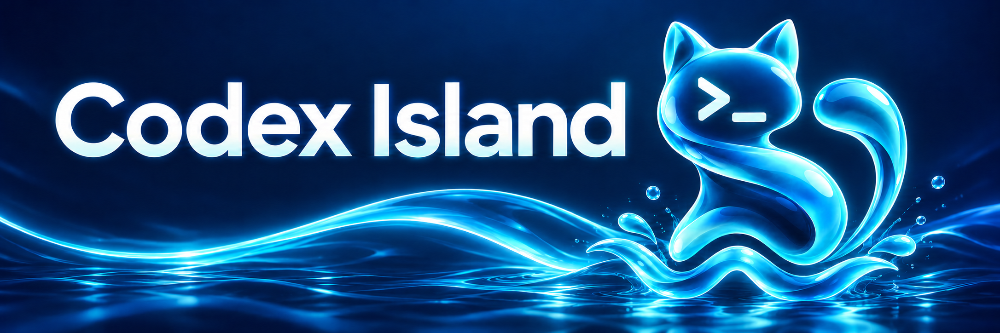
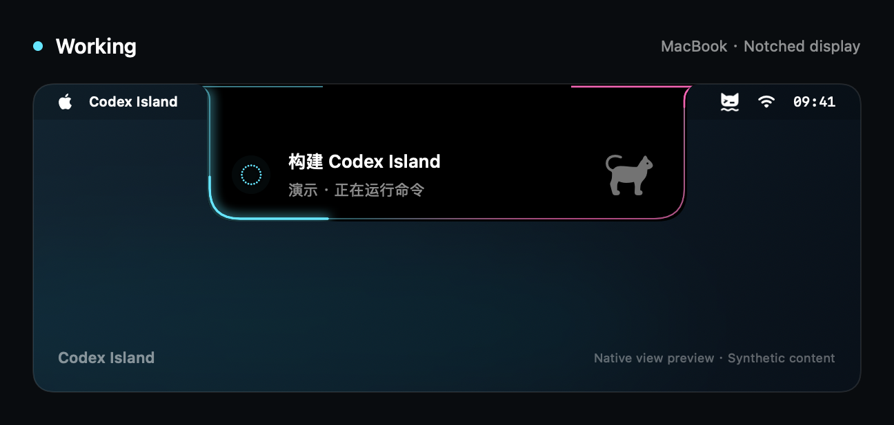
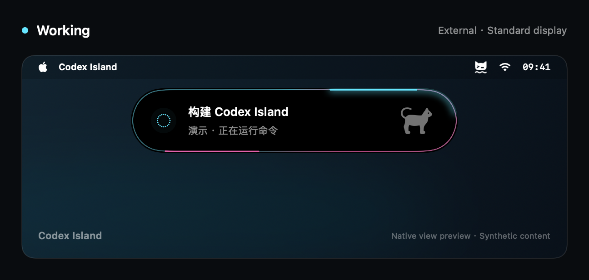
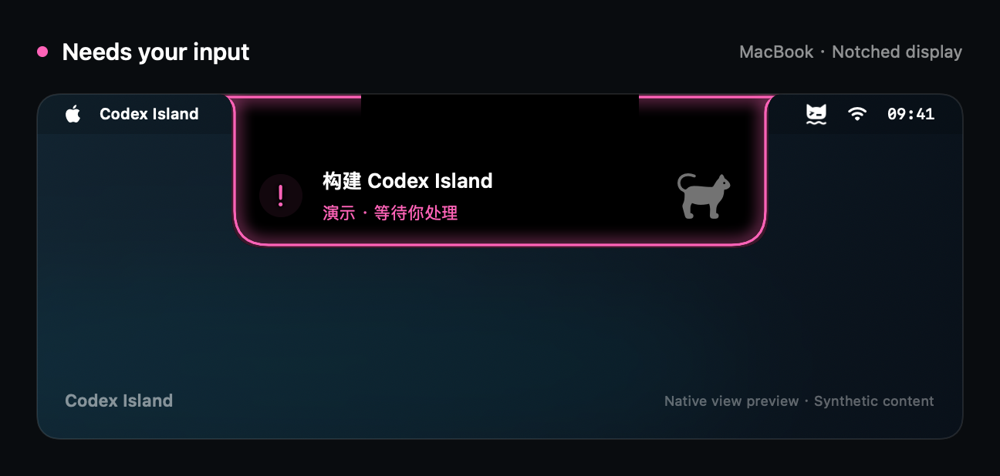
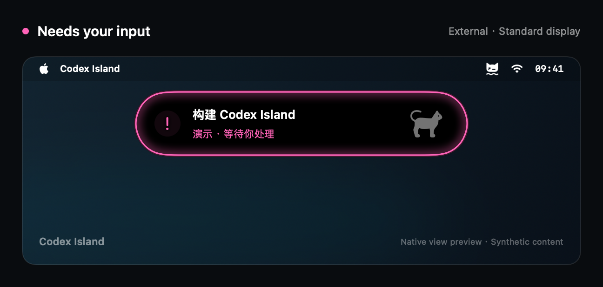
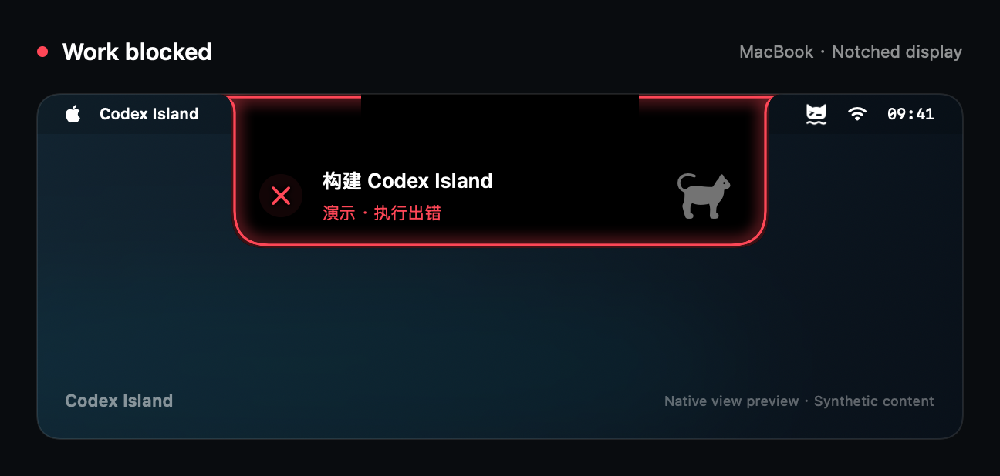
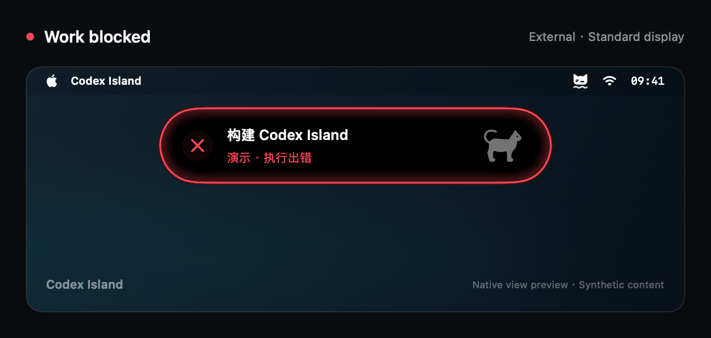
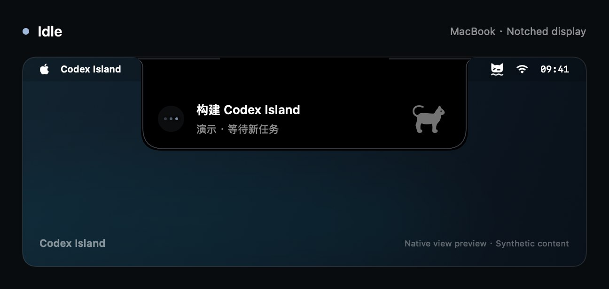
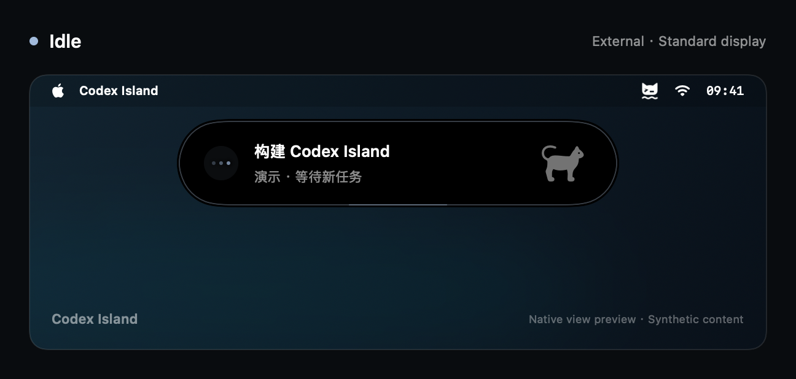

<p align="center">
  
</p>

<h1 align="center">Codex Island</h1>

<p align="center">Your Codex session, at a glance.<br>A native macOS status island with activity, input reminders, and a little company.</p>

<p align="center">
  
  
  
  <a href="https://github.com/WaterWaters/codex-island/actions/workflows/ci.yml"></a>
  <a href="LICENSE"></a>
</p>

<p align="center">
  <strong>English</strong> · <a href="docs/README.zh-CN.md">简体中文</a> · <a href="docs/README.zh-TW.md">繁體中文</a> · <a href="docs/README.ja.md">日本語</a>
</p>

<p align="center">
  <a href="#previews">Preview</a> · <a href="#features">Features</a> · <a href="#getting-started">Get started</a> · <a href="#privacy">Privacy</a> · <a href="#documentation">Docs</a>
</p>

Codex Island keeps the current local session title and activity near the top of your screen. See when Codex is working or waiting for your answer, then click the island to return to Codex.

**Independent project. Not affiliated with OpenAI.** This is a 0.x preview built around local Codex compatibility.

<a id="previews"></a>
## See the island in action

Four everyday states, on a MacBook with a notch and a standard external display. The island keeps the session title above the current activity and uses a distinct outline for each state.

These are native SwiftUI view renders with synthetic content, showing the current Simplified Chinese UI and the asset-free fallback cat symbol. They are illustrative screen compositions, not desktop screenshots or hardware validation. [How the previews are made](docs/assets/previews/README.md).

| MacBook · Notched display | External · Standard display |
| :---: | :---: |
| <br><strong>Working</strong><br>Follow commands and tool activity at a glance. | <br><strong>Working</strong><br>Follow commands and tool activity at a glance. |
| <br><strong>Needs your input</strong><br>A clear signal when an answer is needed. | <br><strong>Needs your input</strong><br>A clear signal when an answer is needed.  |
| <br><strong>Work blocked</strong><br>A distinct error state when a turn fails. | <br><strong>Work blocked</strong><br>A distinct error state when a turn fails. |
| <br><strong>Idle</strong><br>A quiet presence while Codex is open. | <br><strong>Idle</strong><br>A quiet presence while Codex is open. |

<a id="features"></a>
## A little less window switching

- **Session and activity together.** Follow thinking, commands, file changes, and tool activity in two compact lines.
- **A signal when you are needed.** Recognized unanswered questions trigger a pulse; errors get a distinct visual state.
- **At home on macOS.** SwiftUI and AppKit, notch-aware placement, a menu-bar control, and Reduce Motion support.
- **Make it yours.** Adjust colors, height, visibility, and animation. Middle-click for 30 seconds of click-through.
- **Your Codex companions.** Select built-in, local custom, or locally cached cloud pets. No personal pet images are bundled. If cloud artwork is missing, view the pet in Codex and resync. [Pet sources and limits](docs/pet-animation.md).
- **Local by default.** Read-only access to local state, with no app telemetry or network service.

<a id="getting-started"></a>
## Get started

**Preview packages:** [GitHub Releases](https://github.com/WaterWaters/codex-island/releases). The release workflow publishes a universal DMG and ZIP after its checks pass. [Release guide](docs/releases.md).

**Build from source:** macOS 14+, Swift 6+, and Xcode or Command Line Tools. Install Codex for live local status. There are no third-party Swift package dependencies.

From the project root:

```bash
./Scripts/package_app.sh
open build/CodexIsland.app
```

The app appears in your menu bar. While Codex is running, the island stays visible even when idle; it hides when Codex exits. Show or hide it manually from the menu bar.

> [!NOTE]
> The current package is signed ad hoc for local use and is not notarized. It builds for your current CPU architecture. Apple Silicon with Swift 6.4 has been tested; macOS 14 and Intel runtime validation are still pending.

<a id="usage"></a>
## Everyday use

| Action | Result |
| --- | --- |
| Left-click the island | Open Codex |
| Middle-click the island | Make it translucent and click-through for 30 seconds |
| Open the menu-bar menu | Show or hide the island, choose a pet, change appearance, or resync status and pets separately |
| Enable Reduce Motion or pause animation | Keep the display calm |

The island shows a moving outline while working, an input-colored pulse for recognized questions, a red pulse for errors, and a quieter idle state. Completing a turn does **not** imply an unread result.

<a id="privacy"></a>
## Your sessions stay local

The default source reads the current user's `~/.codex/` databases and active session events. It does not modify Codex data, send chat messages, approve requests, or mark anything read. Parsed events are processed in memory; diagnostic output excludes session titles and conversation payloads.

**Titles are visible on screen and through VoiceOver.** Hide the island before sharing your screen when needed. Approval-button recognition is an optional, off-by-default Accessibility feature; the OS permission is broader than the read-only checks this app performs. See [Security and privacy](SECURITY.md) for details.

<a id="compatibility"></a>
## What to expect

| Capability | Current scope |
| --- | --- |
| Local session titles, activity, and recognized question waits | Available within the local-history adapter's scope |
| Approval-button detection | Experimental; opt-in Accessibility permission; real approval-card validation pending |
| Complete unread state, remote/cloud chats, full Codex pet parity | Not supported |
| All fullscreen/Spaces combinations, display changes, long-run performance | Not fully validated |

Codex's private data formats can change. An incompatible source shows unavailable rather than pretending to be idle. v0.7.3 and later honor an absolute `CODEX_HOME` directory in the launch environment; invalid overrides fail explicitly. Event failures use bounded retries and show limited synchronization while preserving database-confirmed activity. The v0.7.2 release uses `~/.codex/`. Details: [local-source boundaries](docs/local-session-source.md).

<a id="development"></a>
## Development

Run the fixture-based tests:

```bash
./Scripts/test.sh
```

Tests do not require real chats or personal images. Opt-in installed-app checks and performance benchmarks are documented in [Contributing](CONTRIBUTING.md) and [Performance](docs/performance.md).

<details>
<summary>Demo and diagnostics</summary>

Build a separate app with an explicitly labeled demo state:

```bash
PREVIEW_STATE=needsInput ./Scripts/package_app.sh
open build/CodexIslandPreview.app
```

Supported demo states: `running`, `needsInput`, `blocked`, `ready`, and `idle`.

Read aggregate diagnostics without printing titles or chat content:

```bash
./build/CodexIsland.app/Contents/MacOS/CodexIsland --diagnose
./build/CodexIsland.app/Contents/MacOS/CodexIslandProbe --watch 10
```

For a custom producer, see the [explicit status-file contract](docs/status-input.md). This is a project-owned development interface, not a Codex API.

</details>

<a id="documentation"></a>
## Documentation

Start with the [documentation index](docs/README.md) for architecture, source behavior, pet animation, benchmarks, and release checks. Most technical guides are currently written in Chinese; the project overview is available in the four languages linked above. These translations do not add app UI locales.

<a id="contributing"></a>
## Contributing

Bug reports, compatibility fixes, and documentation improvements are welcome. Read the [contribution guide](CONTRIBUTING.md) before opening a PR. Use synthetic fixtures and redact diagnostic data. Keep all README translations aligned with the English version; translation guidance lives in the [documentation index](docs/README.md#readme-translations).

<a id="license"></a>
## Credits and license

Created by **Water**. The water-cat identity combines waves with a terminal prompt. [Atoll](https://github.com/Ebullioscopic/Atoll) informed the visual direction.

Project code, documentation, and new brand assets are provided under [MIT](LICENSE). Codex names and runtime-loaded third-party pet assets retain their own ownership; see [asset and trademark notices](THIRD_PARTY_NOTICES.md).
