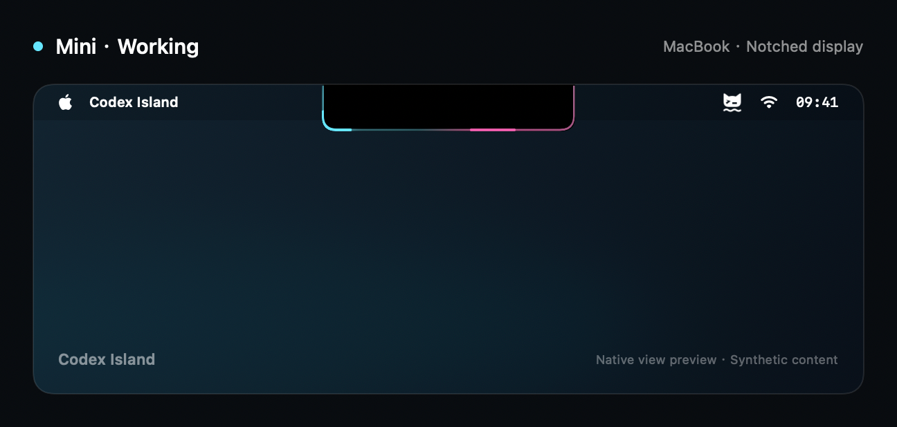
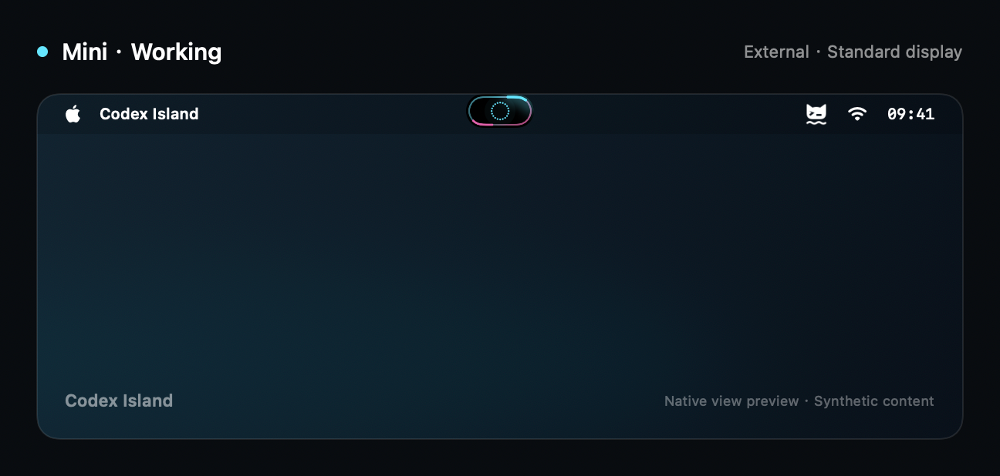
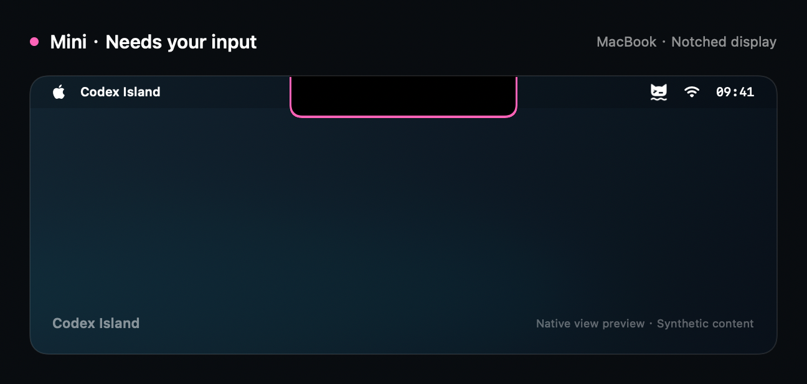
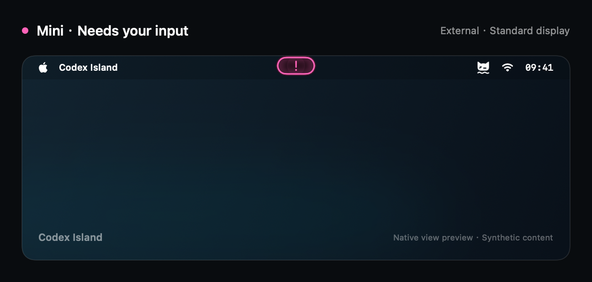
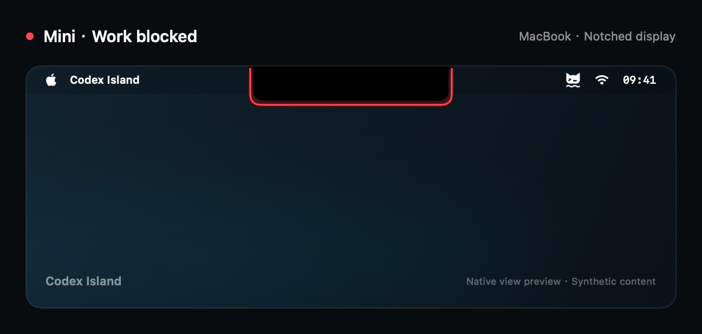
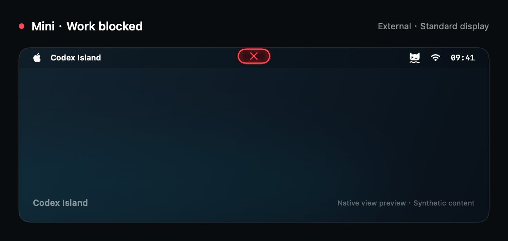
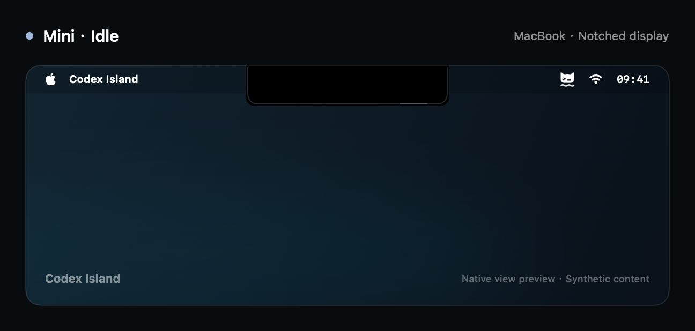
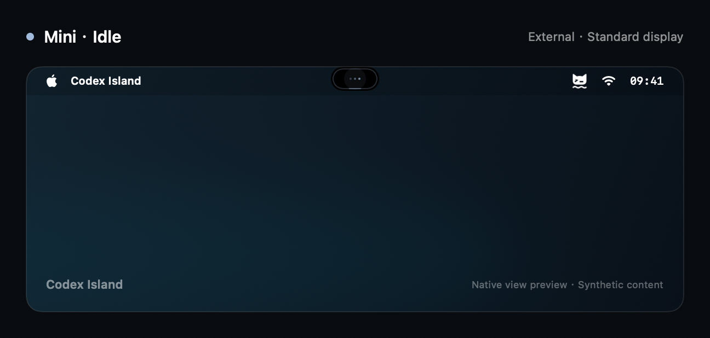

<p align="center">
  
</p>

<h1 align="center">Codex Island</h1>

<p align="center">Codex 与 Claude Code 进展，抬眼可见。<br>原生 macOS 状态岛，让当前活动、待回答的问题和小小陪伴留在屏幕一角。</p>

<p align="center">
  
  
  
  <a href="https://github.com/WaterWaters/codex-island/actions/workflows/ci.yml"></a>
  <a href="../LICENSE"></a>
</p>

<p align="center">
  <a href="../README.md">English</a> · <strong>简体中文</strong> · <a href="README.zh-TW.md">繁體中文</a> · <a href="README.ja.md">日本語</a>
</p>

<p align="center">
  <a href="#previews">界面预览</a> · <a href="#features">功能亮点</a> · <a href="#getting-started">快速开始</a> · <a href="#privacy">隐私</a> · <a href="#documentation">文档</a>
</p>

Codex Island 将本机 Codex 与 Claude Code 会话的标题和活动放在屏幕顶部。工作进展与介入提醒抬眼可见，点击状态岛打开当前来源的桌面应用。

**独立项目，与 OpenAI 或 Anthropic 无关联。** 当前为兼容本机 Codex 与 Claude Code 的 0.x 预览版。

<a id="previews"></a>
## 看看状态岛的样子

四种日常状态，分别展示在 MacBook 刘海屏和普通外接屏上。会话标题在上、当前活动在下，不同状态使用清晰可辨的轮廓提示。

下图使用合成内容和原生 SwiftUI 视图渲染，展示当前简体中文界面与缺少素材时的备用猫图形；屏幕背景为示意构图，并非桌面截图或硬件验收证据。[预览生成方式](assets/previews/README.md)。

| MacBook · 刘海屏 | 外接显示器 · 普通屏 |
| :---: | :---: |
| <br><strong>工作中</strong><br>抬眼查看命令和工具活动。 | <br><strong>工作中</strong><br>抬眼查看命令和工具活动。 |
| <br><strong>需要你</strong><br>需要回答时，给你清晰的提示。 | <br><strong>需要你</strong><br>需要回答时，给你清晰的提示。 |
| <br><strong>工作受阻</strong><br>回合失败时，使用独立的错误状态。 | <br><strong>工作受阻</strong><br>回合失败时，使用独立的错误状态。 |
| <br><strong>空闲</strong><br>Codex 开着时，安静留在视线里。 | <br><strong>空闲</strong><br>Codex 开着时，安静留在视线里。 |

### Mini 模式

更轻的常驻方式：普通屏顶部居中显示 44 × 22 pt 短胶囊，刘海屏自动贴合刘海外缘显示灯带。从菜单栏 **Mini 模式** 或 **设置 → 外观 → 显示模式** 切换。悬停查看状态，点击打开当前来源的桌面应用；Mini 不显示文字和宠物，原有宠物与高度用于完整模式。开启标题隐私后，悬停与 VoiceOver 也隐藏标题。

| 刘海屏 | 普通屏 |
| :---: | :---: |
| <br><strong>工作中</strong> | <br><strong>工作中</strong> |
| <br><strong>需要你</strong> | <br><strong>需要你</strong> |
| <br><strong>工作受阻</strong> | <br><strong>工作受阻</strong> |
| <br><strong>空闲</strong> | <br><strong>空闲</strong> |

<a id="features"></a>
## 少切几次窗口

- **标题与活动，一起呈现。** 两行信息展示思考、命令、文件修改和工具活动。
- **需要你时，给个提示。** 已识别的待回答问题触发脉冲，错误使用独立视觉状态。
- **融入 macOS。** SwiftUI 与 AppKit 原生界面，避让刘海，支持菜单栏控制和减少动态效果。
- **按你的习惯调整。** 自定义颜色、高度、显隐和动画；中键点击即可临时穿透 30 秒。
- **你的 Codex 小伙伴。** 支持内置、本地自定义和本机已缓存的云端宠物，不随包携带个人图片。云端素材缺失时，在 Codex 查看该宠物后重新同步。[素材来源与限制](pet-animation.md)。
- **默认只在本机工作。** 只读本地状态，应用没有遥测或网络服务。

<a id="getting-started"></a>
## 快速开始

**v0.9.0 新增 Claude Code 兼容。** 在菜单栏或设置 → 连接中选择 Codex、Claude 或自动轮播；原有偏好保留，默认仍为 Codex。

**预览版安装包：** [GitHub Releases](https://github.com/WaterWaters/codex-island/releases)。发布流程检查通过后，会提供 universal DMG 和 ZIP。[发布指南](releases.md)。

**从源码构建：** 需要 macOS 14+、Swift 6+，以及 Xcode 或 Command Line Tools。实时本机状态需要安装 Codex 或受支持的 Claude Code 入口。项目没有第三方 Swift 包依赖。

在项目根目录执行：

```bash
./Scripts/package_app.sh
open build/CodexIsland.app
```

启动后可在菜单栏找到应用。状态岛跟随所选来源的连接状态，已识别的空闲会话继续显示；也可从菜单栏手动显示或隐藏。

v0.8.0 新增可跳过的首次引导，以及常规 / 外观 / 连接 / 实验功能四组设置。连接页提供下一步和脱敏诊断复制。[首次使用与连接检查](getting-started.md)。

v0.8.0 另提供标题隐私、可选登录时启动、主动启用的 ⌃⌥⌘I 显隐快捷键、固定显示器与重接恢复，以及默认 / 静谧 / 高对比预设。设置即时生效，登录批准与快捷键冲突显示实际结果。

> [!NOTE]
> 当前应用包只做了本机 ad-hoc 签名，未公证，默认构建当前 CPU 架构。已验证 Apple Silicon / Swift 6.4；macOS 14 和 Intel 的实机运行仍待验收。

<a id="usage"></a>
## 日常使用

| 操作 | 效果 |
| --- | --- |
| 左键点击状态岛 | 打开当前来源的桌面应用 |
| 中键点击状态岛 | 半透明，并让鼠标穿透 30 秒 |
| 打开菜单栏菜单 | 显示或隐藏、换宠物、调整外观，分别重新同步状态和宠物 |
| 开启减少动态效果，或暂停动画 | 保持安静的显示效果 |

工作时轮廓流动，已识别的问题等待使用介入色脉冲，错误使用红色脉冲，空闲时进入低亮状态。回合完成**不等于**存在未读结果。

<a id="privacy"></a>
## 会话数据留在本机

默认来源只读当前用户的 `~/.codex/` 数据库和活动会话事件，不修改 Codex 数据，不发送聊天、批准请求或标记已读。事件解析在内存中处理，诊断输出不包含会话标题或聊天载荷。

**默认会显示标题。** v0.8.0 提供标题隐私，覆盖岛、悬停和 VoiceOver；分享屏幕前也可按需隐藏状态岛。审批按钮识别是默认关闭的可选辅助功能，需要用户自行授权；系统权限比应用实际执行的只读检查范围更广。详见 [安全与隐私](../SECURITY.md)。

<a id="compatibility"></a>
## 当前能力与边界

| 能力 | 当前范围 |
| --- | --- |
| 本机会话标题、活动、已识别的问答等待 | 在本机历史适配器覆盖范围内可用 |
| 审批按钮识别 | 实验功能；需主动授权辅助功能；真实审批卡片验收待完成 |
| 完整未读、远端 / 云端聊天、与 Codex 宠物完全同源 | 不支持 |
| 所有全屏 / Space 组合、显示器变化、长时性能 | 尚未完整验收 |

Codex 的内部数据格式可能变化。来源不兼容时会显示不可用，不会假装空闲。v0.7.3 起支持启动环境中的绝对目录 `CODEX_HOME`，无效覆盖会明确报错；事件失败会有界退避，并在保留数据库已证实活动的同时显示同步受限。已发布的 v0.7.2 读取 `~/.codex/`。详见 [本机来源边界](local-session-source.md)。

### v0.9.0 的 Claude Code 支持

菜单栏及连接设置可选 **Codex**、**Claude** 或 **自动轮播**。轮播通常每 6 秒切换，优先保留需要介入或受阻的来源，悬停时暂停；岛和 VoiceOver 标明当前来源。点击 Claude 打开其桌面应用，不猜测终端窗口或精确会话。

Claude 只读本机 `~/.claude` 活动注册表和有界事件投影；自定义目录通过启动环境中的绝对路径 `CLAUDE_CONFIG_DIR` 指定，无效覆盖明确报错。诊断不含标题、路径、会话 ID 或消息载荷；`CodexIslandProbe --source all` 可检查两个来源。

已记录的兼容对象为 Claude Code 2.1.309 的 `claude-desktop-3p` 入口，CLI / IDE 注册表覆盖仍待验证。缺失、歧义或不可读来源显示不可用或同步受限，完成不等于未读；宠物仍使用本机 Codex 素材。[Claude 来源与限制](claude-session-source.md)。

<a id="development"></a>
## 开发

运行基于夹具的测试：

```bash
./Scripts/test.sh
```

测试不需要真实聊天或个人图片。本机安装版素材检查与性能基准需显式开启，方式见 [贡献指南](../CONTRIBUTING.md) 与 [性能说明](performance.md)。

<details>
<summary>演示与诊断</summary>

构建独立应用，使用明确标记为“演示”的状态：

```bash
PREVIEW_STATE=needsInput ./Scripts/package_app.sh
open build/CodexIslandPreview.app
```

支持的演示状态：`running`、`needsInput`、`blocked`、`ready`、`idle`。

只输出聚合诊断，不打印标题或聊天正文：

```bash
./build/CodexIsland.app/Contents/MacOS/CodexIsland --diagnose
./build/CodexIsland.app/Contents/MacOS/CodexIslandProbe --watch 10
```

自备生产者的接入方式见 [显式状态文件契约](status-input.md)。这是本项目的开发接口，不是 Codex API。

</details>

<a id="documentation"></a>
## 文档

通过 [文档索引](README.md) 查看架构、状态来源、宠物动画、性能基准与发布检查。技术文档目前主要以中文编写，项目介绍提供上方四种语言；v0.8.0 支持跟随系统或英语、简繁中文、日语应用界面。

<a id="contributing"></a>
## 参与贡献

欢迎报告问题、修复兼容性和改进文档。提交 PR 前请阅读 [贡献指南](../CONTRIBUTING.md)，使用合成夹具并对诊断资料脱敏。各语言 README 以英文主版本为基准同步，规则见 [翻译维护说明](README.md#readme-translations)。

<a id="license"></a>
## 致谢与许可

由 **Water** 创建。水猫标识将水波与代码提示符结合；视觉方向参考了 [Atoll](https://github.com/Ebullioscopic/Atoll)。

项目代码、文档和新品牌素材采用 [MIT](../LICENSE)。Codex 名称及运行时加载的第三方宠物素材保留各自权属，详见 [素材与商标说明](../THIRD_PARTY_NOTICES.md)。
