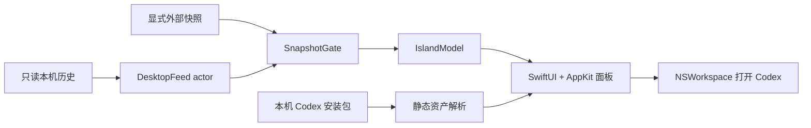

# 产品与技术设计

版本：0.7.2（待发布）。macOS 14+，Swift 6 / SwiftUI / AppKit，无第三方 Swift 包依赖。

## 展示与交互

屏幕顶部固定两行：会话标题与当前活动。运行时显示霓虹轮廓，问答等待使用介入色脉冲，错误使用红色脉冲；Codex 运行期间空闲常驻，退出后隐藏。无刘海使用胶囊，有刘海时避让物理摄像头区域。

普通左键打开 Codex，中键触发 30 秒半透明穿透。菜单栏负责显示、宠物、动态效果、外观设置、手动同步与退出。隐藏偏好持久化，临时穿透仅存在内存。默认不注册登录项。

公开版本默认使用系统图标；用户可选择从本机 Codex 安装包只读加载内置宠物。个人宠物、个人截图及第三方图片不进入源码或应用包。素材失败时保留可用图标 / 内容，不需要私人文件即可构建运行。

标题及活动位于最上层；宠物位于中间层。所选宠物工作时停在右侧，空闲时可短距离漫步，位置及步态共用时间轴。减少动态效果、隐藏或休眠时暂停相关动画。具体时序见 [宠物播放](pet-animation.md)。

## 模块与数据流

默认读取当前用户 ~/.codex 中的两个 SQLite 数据库及活动回合事件，只选择根会话与状态必要字段；不把完成等同未读。快照校验版本、完整性、顺序与新鲜度。问答按调用 ID / 问题下标配对，异步受理回执不等于已回答。优先级为 needsInput → blocked → ready → running。

辅助功能审批识别默认关闭，需用户自行授权，只读 Codex 按钮角色和标签；没有可靠会话 ID 时使用通用 Codex 标题。不可仅因命令提权、自动审核或长时间无输出推断人工审批。

查询和文件读取由独立 actor 执行；轮询与系统通知刷新合并，休眠 / 取消后不提交迟到结果。来源读取预算、性能实测与未验证边界见 [性能说明](performance.md)，数据隐私见 [SECURITY.md](../SECURITY.md)。

## 能力边界

内部数据库和 ASAR 字面量不是官方稳定 API。远端 / 云端聊天、完整未读、全部审批、跨 Space / 全屏组合、最低系统和 Intel，以及 30 分钟整应用性能尚未完整验收。来源失败明确显示不可用，不自动回退演示。

[Atoll](https://github.com/Ebullioscopic/Atoll) 仅为视觉参考；[素材与品牌边界](../THIRD_PARTY_NOTICES.md) 单独说明。
