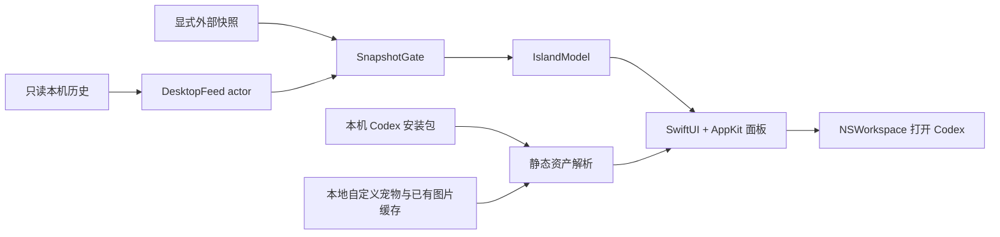

# 产品与技术设计

版本：v0.7.3 之后的未发布源码。macOS 14+，Swift 6 / SwiftUI / AppKit，无第三方 Swift 包依赖。

## 展示与交互

屏幕顶部固定两行：会话标题与当前活动。运行时显示霓虹轮廓，问答等待使用介入色脉冲，错误使用红色脉冲；Codex 运行期间空闲常驻，退出后隐藏。无刘海使用胶囊，有刘海时避让物理摄像头区域。

普通左键打开 Codex，中键触发 30 秒半透明穿透。菜单栏负责显示、宠物、动态效果、外观设置、手动同步与退出。隐藏偏好持久化，临时穿透仅存在内存。默认不注册登录项或全局快捷键；用户可主动启用登录时启动和 ⌃⌥⌘I 显隐。登录项读取系统实际状态，快捷键冲突明确显示。

当前源码默认选择 Codex 内置宠物；菜单和设置同时列出本地自定义与本机已缓存的云端宠物，不再提供“系统图标”选项。旧系统图标偏好迁移至 Codex，其他外观设置保留。个人宠物、个人截图及第三方图片不进入源码或应用包。素材失败时保留已解码宠物；初次缺少任何可用素材时显示静态备用图形，基础状态继续可用。具体来源和限制见 [宠物素材](pet-animation.md)。

设置页使用原色水猫品牌图标。菜单栏使用专为 18pt 绘制的白色透明猫耳 / 终端 / 单水波标识，AppKit 按目标屏幕比例直接绘制，避免将复杂标志缩成单张位图后再缩放。README 八张状态 / 屏幕组合预览复用真实原生视图，使用合成内容，四种文档语言共享图片并各自翻译简介。

标题及活动位于最上层；宠物位于中间层。所选宠物工作时停在右侧，空闲时可短距离漫步，位置及步态共用时间轴。减少动态效果、隐藏或休眠时暂停相关动画。具体时序见 [宠物播放](pet-animation.md)。

## 首次使用与连接设置

正常启动提供可跳过的三步引导，完成 / 跳过标记独立于外观设置；设置中可从头重看。演示、外部状态、图库与诊断入口使用内存偏好，不自动引导，也不写正式偏好。设置按常规、外观、连接、实验功能分组，保留原有宠物 / 外观 / 可选权限控件。连接页分别呈现安装、运行、缺数据、不兼容、临时失败与事件同步健康，复用来源重置，不建立第二套来源状态。

脱敏诊断通过固定字段值类型构建，只允许版本、来源类别、固定原因和聚合健康计数，版本额外限定数字与点；不接受标题、会话 ID、路径或底层错误描述。复制只写剪贴板，不发送诊断。应用使用稳定资源 key 与包 bundle，支持跟随系统及英语、简繁中文、日语即时切换；来源枚举、诊断字段和审批识别标签独立于界面语言。标题隐私覆盖岛、悬停与无障碍描述。操作见 [首次使用](getting-started.md)。

## 显示与预设

默认按系统主显示器 ID 定位，可用屏幕 UUID 固定选择；断开回落主屏，重接恢复。面板使用目标屏幕全局坐标、安全区和实际 backing scale 对齐，跨屏移动不播放位置动画。隐藏会移除 SwiftUI 内容树以停止时间轴，恢复后重建；系统睡眠、屏幕睡眠、会话非活动分别跟踪，必须全部解除才恢复轮询。

标准预设保留原有霓虹效果，静谧降低干扰，高对比使用连续清晰轮廓和静态状态符号。文字与符号共同表达状态，不只依赖颜色。自定义颜色与已有高度设置兼容；偏好结构仍为 v1，旧版可忽略新增字段。

## 模块与数据流

默认读取当前用户 ~/.codex 中的两个 SQLite 数据库及活动回合事件，只选择根会话与状态必要字段；不把完成等同未读。快照校验版本、完整性、顺序与新鲜度。问答按调用 ID / 问题下标配对，异步受理回执不等于已回答。优先级为 needsInput → blocked → ready → running。

辅助功能审批识别默认关闭，需用户自行授权，只读 Codex 按钮角色和标签；没有可靠会话 ID 时使用通用 Codex 标题。不可仅因命令提权、自动审核或长时间无输出推断人工审批。

查询和文件读取由独立 actor 执行；轮询与系统通知刷新合并，休眠 / 取消后不提交迟到结果。来源读取预算、性能实测与未验证边界见 [性能说明](performance.md)，数据隐私见 [SECURITY.md](../SECURITY.md)。

v0.7.2 之后的源码统一 GUI / probe 的 `CODEX_HOME` 配置解析，并为事件读取失败增加按会话 / 回合隔离的有界退避。来源健康信息随快照进入 UI，数据库已证实的活动与事件同步受限分别表达；菜单栏可独立重新同步状态。手动重置和休眠改变来源代际，迟到结果不能回写。具体语义见 [本机来源](local-session-source.md)。后续未发布源码用有界流式 JSON 投影处理大事件；读取仍保持每源每次 256 KiB，完整记录校验后才提交问答事件，不通过跳过坏记录宣称追平。

## 能力边界

内部数据库和 ASAR 字面量不是官方稳定 API。远端 / 云端聊天、完整未读、全部审批、跨 Space / 全屏组合、最低系统和 Intel，以及 30 分钟整应用性能尚未完整验收。来源失败明确显示不可用，不自动回退演示。

[Atoll](https://github.com/Ebullioscopic/Atoll) 仅为视觉参考；[素材与品牌边界](../THIRD_PARTY_NOTICES.md) 单独说明。
